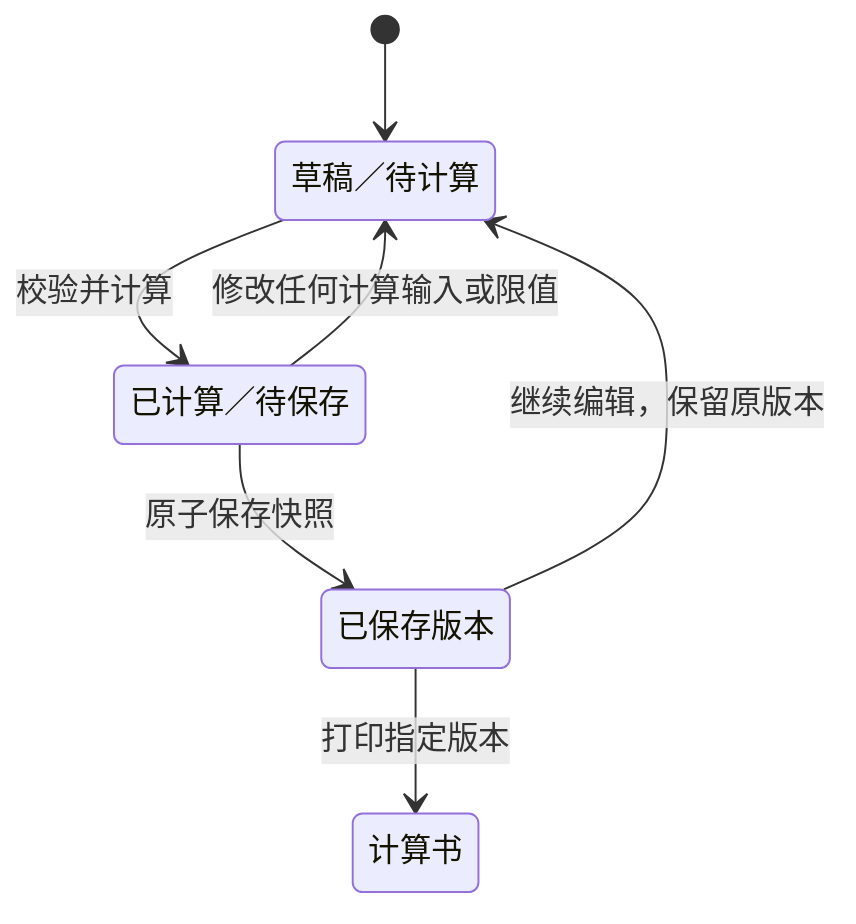

# 化工工艺计算工作台 · 工程设计

产品范围与验收条件见 [产品方案](proposal.md)。本文规定首版的页面行为、计算口径、数据契约、验证与发布路径。

## 页面与操作

| 页面 | 内容与行为 |
| --- | --- |
| 项目列表 | 显示项目名、计算单数、最近更新；提供新建项目、打开冷却水示例、导入项目文件。示例打开后生成独立项目草稿，可以修改而不影响下一次加载。 |
| 项目详情 | 按管线编号列出计算单、最新快照和编辑中的草稿；提供新建计算单、备份项目及配置项目共用限值。 |
| 管线计算单 | 共用参数区填写管线编号、介质及入口和出口标识；工况表填写名称、流量、密度及动力黏度；方案表填写名称、实际内径、管长、绝对粗糙度、出口减入口高差和局部阻力系数。限值区逐项选择继承项目限值、自定义或未设置。关键物性及系数提供依据字段。 |
| 比选结果 | 每行对应一个工况与管径组合，展示流速、Re、流态、沿程损失、局部损失、阻力压降、高差压力项和进出口静压差；结果列标注单位，状态有文字提示。点开一行查看公式、原始输入、换算后的代入值和判定依据。 |
| 版本与计算书 | 选定方案并填写理由后保存版本；未选方案也可保存比选过程。任意两个版本可对比参数、结果、校核状态及选型结论。计算书按指定版本打印，草稿预览明确标记为草稿。 |

首次打开可直接试算示例。参数修改后，旧结果应失效，界面自动用当前输入重新计算，校验未通过时标出待完善项。切换显示单位时换算原值，保留同一物理量。只有当前计算结果与草稿输入一致时才可保存新版本。结果横向内容可在表格内滚动，移动端可展开单行；所有输入提供可见标签，超限状态同时用文字表达。选择候选管径是工程师的操作，工具按输入的判据列出每个工况。

## 计算方法与结果口径

首版支持稳态、单相、不可压牛顿液体在单一满流圆管段内的正向流动。每个方案沿程保持同一实际内径，流向定义为入口至出口，管段内无泵等轴功设备。气体、两相、变径、支路、瞬态、非牛顿流体均超出模型范围。若用户需要做这些任务，明确提示另用相应方法。将算法版本固定为 `darcy-weisbach-v1`，计算书写明版本及使用的摩阻因子关联式。

| 项 | 归一化与计算规则 |
| --- | --- |
| 输入单位 | 流量支持 m³/h、m³/s、L/s；实际内径和绝对粗糙度支持 mm、m；管长和高差用 m；密度用 kg/m³；动力黏度支持 mPa·s、Pa·s；限值用 m/s、kPa。内部统一 SI，保留输入值及单位。DN 可写入方案名称，计算必须用实际内径。 |
| 基本量 | `A = πD²/4`，`v = Q/A`，`Re = ρvD/μ`。Q、D、ρ、μ 为有限正值；L、ε、K 为有限非负值；Δz 可正、可负、可为零。要求 ε 小于 D，L 为零时保留局部损失计算。 |
| 摩阻因子 | Re < 2000 使用 Darcy 摩阻因子 `f = 64/Re`；Re > 4000 使用 Swamee–Jain 式 `f = 0.25 / log10(ε/(3.7D) + 5.74/Re^0.9)²`；2000 ≤ Re ≤ 4000 为本产品的停算区间，显示流速、Re 和高差项，摩阻、压降及相关校核标为未判定。 |
| 压力拆分 | 动压项 `qᵥ = ρv²/2`；沿程损失 `Δp_f = f(L/D)qᵥ`；局部损失 `Δp_K = Kqᵥ`；阻力压降 `Δp_loss = Δp_f + Δp_K`；高差压力项 `Δp_z = ρgΔz`，其中 `Δz = z_out − z_in`、`g = 9.80665 m/s²`。计算书按 `p_in − p_out = Δp_loss + Δp_z` 报告静压差，允许负值。 |
| 局部阻力 | K 是按当前方案管内流速定义的总局部阻力系数，由用户填写并提供依据。方案可设默认 K，特定工况可覆盖，并记录取值来源与适用流态。选择明确无局部损失时写入 K=0；K 缺失或不适用于该工况时，只显示有效分项，局部损失、阻力压降、总静压差及关联校核为空并给出原因。 |
| 校核与显示 | 流速限值比较 v；阻力压降限值比较 Δp_loss。限值可留空且只能为有限非负值，用未舍入的 SI 数值比较，等于上限判满足。任何已知项超限时该行标超限；全部两项已比较且满足时标满足；其余标未校核或不可判定并列出原因。方案汇总在任一行超限时标超限，全部工况已判满足时标满足，其余标未完成校核并列出未判定项。 |

公式参考美国 EPA EPANET 2.2 的沿程与局部损失定义及摩阻因子算法。EPANET 本身会对过渡流做插值，首版采用停算规则并向用户提示。结果按适用范围出具计算书，计算结果和用户填写的校核限值均不自动变成项目设计结论。[网络模型](https://usepa.github.io/EPANET2.2/3_network_model.html) · [计算算法](https://usepa.github.io/EPANET2.2/12_analysis_algorithms.html)

### 用于验收的示例

示例项目为「循环冷却水改造」，计算单为「冷却水供水支线」。共用条件：管长 120 m，绝对粗糙度 0.045 mm，高差 +4 m，密度 997 kg/m³，动力黏度 0.89 mPa·s。两方案实际内径分别为 102.3 mm 和 128.2 mm，K 分别为 4.8 和 5.4。物性与 K 来源栏标注为示例项目给定值。示例限值为 2 m/s 和 35 kPa，供演示项目内比选。

| 工况 | 102.3 mm 流速 / 阻力压降 | 128.2 mm 流速 / 阻力压降 |
| --- | ---: | ---: |
| 正常 30 m³/h | 1.014 m/s / 14.34 kPa | 0.646 m/s / 5.00 kPa |
| 最大 45 m³/h | 1.521 m/s / 31.05 kPa | 0.968 m/s / 10.79 kPa |
| 调整后最大 55 m³/h | 1.859 m/s / 45.64 kPa | 1.184 m/s / 15.82 kPa |

初始版本包含正常及最大两个工况。新版把同一最大工况改为 55 m³/h，保存后，小内径方案在最大工况的阻力压降由满足变为超限，另一方案仍满足。各行高差压力项约 +39.11 kPa，单独列出。

## 数据模型与迁移

存储使用同源 IndexedDB，数据库名 `chemical-calculator`，初始数据库版本 1。标识采用 UUID，时间戳为 ISO 8601 UTC，界面按本地时间显示。

| 对象仓库 | 主键及索引 | 主要字段 |
| --- | --- | --- |
| `projects` | `id`；`updatedAt` | 名称、备注、可选流速及阻力压降共用限值、创建及修改时间 |
| `worksheets` | `id`；`projectId`、`[projectId, updatedAt]` | 项目 ID、管线编号、计算类型、草稿、草稿修订号、最新快照序号、更新时间 |
| `revisions` | `[worksheetId, sequence]` | 快照格式版本、算法版本、原始输入及取值来源、归一化 SI 输入、结果明细、生效限值、继承/自定义来源及判定、选型决定与理由、时间戳 |

草稿的工况、方案分别持有稳定 ID。某方案的工况 K 覆盖按工况 ID 引用；删除工况时同步移除其覆盖，已有快照保留原始状态。每个结果用工况 ID 与方案 ID 唯一定位，对比时可识别新增、删除、改名和数值变化；只有同一物理量与单位维度的差异才展示数值增减。缺值保留为 `null`，不得与零混用。快照插入后只读；继续编辑创建或更新草稿，保存新版本时以同一事务追加快照、更新计算单版本和项目时间。以草稿修订号检查多标签页写入，检测到冲突后提示重新加载，避免静默覆盖。

首次打开在 `onupgradeneeded` 建仓库与索引。后续版本用前向增量升级，保留历史快照字段及算法版本，失败则回滚；有旧标签页占用时提示关闭其他标签页。改动项目共用限值只影响继承该值的草稿；历史快照保留当时的有效限值。数据库版本、备份格式版本与算法版本分别维护。每个发布版要验证上一版备份和数据库能读；不兼容存储升级须单独制定恢复路径。

## 模块边界与文件契约

| 模块接口 | 输入与输出 |
| --- | --- |
| `normalize(draft)` | 校验输入结构和数值，返回带路径的问题列表或以 SI 表示的输入；纯函数。 |
| `calculate(normalized)` | 返回各方案与工况组合的结果、流态、诊断及可复算明细；无存储与网络操作。 |
| `evaluate(results, limits)` | 返回分项、组合、方案的校核状态及原因；与显示格式解耦。 |
| `saveDraft / saveRevision / listRevisions` | 统一在存储模块读写；界面在事务提交后才显示保存成功。 |
| `compareRevisions(before, after)` | 按稳定 ID 比较原始输入、标准化数值、结果、状态与选型理由。 |
| `renderReport(snapshot)` | 从指定快照构建可打印页面，包含算法版本和数据来源；用当前草稿预览时标注草稿。 |
| `exportProject / importProject` | 在浏览器读写版本化 JSON，完成独立的项目备份与恢复。 |

模块调用方向为页面控制器 → 输入归一化 → 计算 → 校核，页面控制器另调存储、版本比较和文件模块。采用原生 ES modules 和静态资源，无 HTTP API。

项目备份是 UTF-8 JSON，顶层包含 `format: "chemical-calculator.project"`、`schemaVersion: 1`、`exportedAt`、`project`、`worksheets`、`revisions`。备份包含草稿、快照和历史计算结果，打印报告适合交接阅读，JSON 适合恢复后继续计算。导入先解析格式、检查结构、数值域、记录 ID 唯一性与所有引用，再在一笔事务写入；按已知字段构造对象，文本只作纯文本渲染。导入创建项目副本，生成新项目与计算单 ID 并重映射相关引用，工况与方案的局部 ID 以及快照序号、时间、旧算法版本保持原样。遇到未知版本拒绝并提示使用兼容版本；损坏文件、超出浏览器存储容量和事务失败均保留当前库。

草稿的数字输入以原始字符串往返，允许恢复尚待修正的录入值，恢复后仍在字段旁显示校验结果。项目限值、已保存快照中的数字输入和快照计算结果在导入时按其数据契约校验。

## 状态与错误契约

| 情况 | 处理 |
| --- | --- |
| 必填项缺失、非有限数、单位不支持 | 定位到字段，写明允许范围；不生成与当前输入不匹配的结果。 |
| 单个组合落入过渡区、K 不适用或计算溢出 | 限定问题影响到当前组合及依赖分项，其余有效组合正常展示。明确不可判定原因；可保存并打印带说明的计算记录。 |
| 缺少校核限值 | 有效物理量仍可计算；相应状态为未校核，不把未给的限值默认为零或套用通用阈值。 |
| IndexedDB 不可用、空间不足或更新冲突 | 在当前会话保留未保存内容，明确说明持久化失败；支持从当前会话导出可恢复的草稿项目，重试或重新打开后再保存。 |
| 导入格式错误、损坏、引用无效或版本过新 | 指明失败类别、保留当前项目与草稿，禁止部分导入。 |
| 用户取消打印 | 保留原快照与页面，打印动作不产生新版本。 |

报告包含项目和管线编号、版本及日期、方法和适用边界、输入/单位/来源、工况比选结果、限值及判定、选型理由和可复算明细。采用打印样式去除交互元素；从浏览器打印对话框保存 PDF，保留页眉、表头、页码或版本标记，以便多页复核。

## 架构决策

| 决策 | 理由 | 备选方案 |
| --- | --- | --- |
| 原生 ES modules + HTML/CSS | 单用途静态工作台可直接托管，计算函数可独立运行和验证。 | 引入前端框架可以帮助更大型项目复用组件，首版不需要相应构建与运行开销。 |
| IndexedDB + 版本化项目文件 | 事务支持跨仓库快照和全量导入，用户可自主备份、迁移。 | localStorage 适合少量设置，缺少多记录事务；服务端数据库留待账户、权限和团队协作需求。 |
| 一种算法、可展开完整计算链 | 优先保证验收对照一致，报告能追溯到当时的算法与输入。 | 多算法切换应随适用范围和独立验证一起扩展。 |
| 计算书用打印样式 | 同一快照生成可读页面与 PDF，保留文字搜索能力。 | 自研 PDF 生成器会额外增加中文排版、分页与浏览器兼容的工作量。 |
| GitHub Actions 发布独立静态项目 | 可先验证再发布，只打包明确允许的公开资源，支持项目子路径。 | 分支发布配置简单；工作流便于将测试和产物检查纳入发布门槛。 |

### 关键文件与复用点

| 文件 | 计划改动 |
| --- | --- |
| `index.html`、`styles.css` | 将现有页面壳改成项目列表、管线表单、比选与报告视图；复用现有 CSS 的响应式布局和基础表单样式。旧页面引用的脚本尚不存在，替换为新的入口。 |
| `src/app.mjs`、`src/hydraulics.mjs` | 页面入口、交互及单位归一化、计算、校核。 |
| `src/storage.mjs`、`src/project-file.mjs` | 本地持久化、快照、迁移和备份导入导出。 |
| `src/report.mjs`、`print.css` | 计算书渲染及打印分页。 |
| `examples/cooling-water.json` | 可公开的虚构项目算例；用户数据通过浏览器本地文件导入。 |
| `tests/`、`.github/workflows/pages.yml` | 独立计算对照、端到端校验及 GitHub Pages 发布工作流。 |

现有目录仅有 HTML/CSS 页面原型，没有可复用的计算或存储实现；保留通用视觉样式，移除与工艺设计首版不匹配的工具入口。

## 实施与 GitHub 发布

1. 实现输入归一化、计算与校核。先用独立表格复算样例，再验证层流、过渡边界、下降管线、K=0、单位等价和限值恰好相等。
2. 接通项目、草稿、计算快照、版本对比与本地备份。使用冷却水算例完成变更前后比选流程，再用历史脱敏项目评估复核可用性。
3. 增加打印计算书与浏览器端到端验收，验证中文、分页、单位、公式及版本对应关系。
4. 在独立的 GitHub 项目仓库中配置 GitHub Pages，以 `main` 及手动触发为发布入口。PR 仅检查；正式工作流验证后打包并上传明确列出的静态文件，发布任务使用最低所需的 `pages: write` 和 `id-token: write` 权限及 `github-pages` 环境。真实项目数据、导出的报告和备份禁止进入发布产物。
5. 发布前以与仓库名称一致的子路径启动本地预览；页面资源和示例使用相对路径，视图用 hash 或单页状态，刷新时可直接打开。发布后由无登录的浏览器打开 GitHub Pages 给出的 HTTPS 链接，完成示例计算、保存重开、导入导出和打印，观察计算过程中未发出项目数据请求。线上验收通过后记录提交哈希、发布 URL 和验证结果。
6. 发布失败时保留上一个线上版本；功能回归时撤回对应提交并重新发布已验收静态产物。存储结构变更要兼容回滚，用户可用 JSON 备份恢复。

项目网址由 GitHub 仓库实际所有者和仓库名决定。首版使用公开静态工具的托管模式，计算、项目数据及报告均在浏览器端处理。[GitHub Pages 发布配置](https://docs.github.com/en/pages/getting-started-with-github-pages/configuring-a-publishing-source-for-your-github-pages-site) · [浏览器存储及回收机制](https://developer.mozilla.org/en-US/docs/Web/API/Storage_API/Storage_quotas_and_eviction_criteria)

## 测试策略与发布门槛

| 对应验收 | 验证方式 |
| --- | --- |
| AC1 | 从首次进入打开示例，确认示例可计算且重复打开不受已编辑项目影响。 |
| AC2 | 至少两工况乘两方案；替换等价值单位，核对结果一致及组合关联。 |
| AC3 | 使用独立手算或表格验证分项、公式、静压差符号；对合适的单管水力案例以 EPA EPANET 2.2 交叉比对；显示值与计算书按各自精度一致。 |
| AC4 | 覆盖 2000、4000 及两侧，限值缺失、恰好相等、明确超限、K 缺失/零/不适用及非法输入。 |
| AC5 | 创建并编辑两个项目，刷新、关页再打开；模拟写入失败和两标签页冲突，检查保存状态准确。 |
| AC6 | 把最大流量由 45 改为 55 m³/h，验证旧版本不变、差异标识和方案状态改变。 |
| AC7 | 对指定旧版和新版分别打印 PDF，核查版本、中文分页、结果、代入值及取值依据；草稿预览带标记。 |
| AC8 | 导出再导入核对项目、草稿、版本与结果完整；错误格式、未知版本、坏引用或写入失败后确认本机数据未改变。 |
| AC9 | 先以仓库子路径完成冒烟测试；公开发布后从站点 URL 实跑同一流程，检查控制台、资源加载与项目数据网络请求。 |

首版具备发布条件时，计算对照、版本恢复、公开静态部署三项都应通过。试点阶段另外记录首次出单耗时、改工况到新版计算书的耗时、校审人员独立复算成功情况，用来判断项目价值及下一步范围。

同公式的独立对照使用未舍入值，流速、雷诺数和摩阻因子相对误差不超过 0.1%，压力项误差不超过 0.01 Pa 与参考绝对值的 0.1% 中较大者。这是实现验收的数值容差，校核判定仍按项目原始限值执行。参考值为零的工况分别断言零值、符号或未判定状态。若结果和限值舍入后显示相同，但原值导致不同判定，界面及报告在该项展示更高精度，便于复核。
